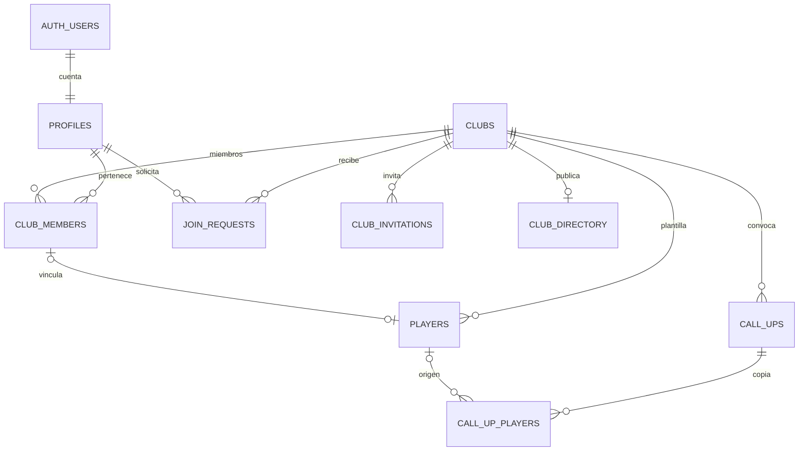

# Datos, Auth y seguridad

## Decisión de autenticación

Supabase Auth no autentica de forma nativa con un nombre de usuario y contraseña: necesita un correo real o teléfono. Para esta fase se ha aprobado **correo real para registro, verificación, recuperación y login**, además de un nombre de usuario único. No se generan correos ficticios ni contraseñas propias.

El registro envía `username` en los metadatos de Auth. Un trigger inserta el perfil dentro de la misma transacción del alta. La base impone la unicidad con `lower(username)`; admite 3–24 caracteres ASCII (letras, números y `_`) para evitar ambigüedades de normalización. Un fallo de formato o duplicidad revierte el alta, sin cuentas huérfanas. Los roles nunca se toman de metadatos editables del usuario. Los correos y contraseñas pertenecen a Supabase Auth; no hay columnas de contraseñas ni correo en las tablas públicas.

La app usa PKCE, sesión persistente y un callback de confirmación. El enlace se debe abrir en el mismo dispositivo/cliente que inició el registro, donde está el verificador PKCE. En móvil, utiliza una build propia de EAS para validar `convosquad://auth/callback`. En web, configura una URL real accesible desde el correo. La recuperación permite enlace PKCE o código OTP de recuperación, seguido de una nueva contraseña y cierre de sesión. El formulario de nueva contraseña exige una sesión de recuperación emitida por Auth; un parámetro de navegación no concede ese acceso. No se ha implementado ni aprobado un servicio que traduzca nombres de usuario a correos para login.

La refactorización posterior añade categorías, PRUEBAS y AYUDAS mediante una quinta migración incremental; consulta [Categorías, pruebas y ayudas](roster-categories.md). No se repite el script inicial en un proyecto ya instalado.

## Tablas

| Tabla | Propósito |
| --- | --- |
| `profiles` | Identidad de aplicación, vinculada 1:1 con `auth.users`; username único |
| `clubs` | Nombre, descripción, zona IANA, creador, privacidad y fecha |
| `club_directory` | Solo ID, nombre y descripción de clubes que optan por búsqueda pública |
| `club_members` | Usuario, club, rol y estado activo; una pertenencia por usuario/club |
| `players` | Ficha independiente: EA ID, dorsal 1–99 opcional, posición, actividad y cuenta opcional |
| `call_ups` | Instante del partido, día local, zona congelada, estado, creador y auditoría |
| `call_up_players` | Copia de cada ficha al convocar, disponibilidad y fecha de respuesta |
| `join_requests` | Solicitud privada, nombre público original, estado y responsable de resolución |
| `club_invitations` | Hash SHA-256, club, caducidad, revocación y contador de usos |



Una misma cuenta puede ser admin en un club y jugador en otro. Una pertenencia puede no tener ficha; una ficha puede no tener cuenta. Solo se permite una ficha vinculada por cuenta y club, y cada ficha tiene una única cuenta. Las posiciones son `POR`, `DFC`, `LI`, `LD`, `MCD`, `MC`, `MCO`, `MI`, `MD`, `EI`, `ED`, `DC`.

## Operaciones y permisos

RLS está habilitado en todas las tablas públicas. Los permisos de columnas complementan RLS: incluso un admin no puede escribir directamente roles, membresías, cuentas vinculadas, copias históricas o tokens. La app no usa `service_role`.

| Información/acción | Anónimo | Jugador activo | Admin activo del club |
| --- | --- | --- | --- |
| Directorio público | Leer | Leer | Leer |
| Datos privados del club | No | Solo sus clubes | Solo sus clubes |
| Perfil | No | Propio y compañeros activos | Propio, compañeros activos y solicitantes pendientes de su club |
| Plantilla | No | Leer | Leer, crear, editar y eliminar |
| Membresías | No | Leer las activas del club | Leer también inactivas; administrar por RPC |
| Convocatorias abiertas y respuestas | No | Leer | Leer |
| Borradores, cerradas, canceladas e históricos | No | No | Leer |
| Disponibilidad | No | Solo propia, si está abierta | Solo propia, si está abierta |
| Solicitudes | No | Solo propias | Las de su club |
| Invitaciones | No | Solo canjear un token válido | Crear, consultar metadatos y revocar |

Los helpers de RLS están en `private`, no expuesto por PostgREST. Consultan las membresías como propietario de la función y evitan la recursión de políticas. Usan `auth.uid()`, `search_path = ''` y referencias cualificadas. Los helpers internos tienen EXECUTE revocado; los de lectura solo se conceden a `authenticated`.

Las funciones públicas `SECURITY DEFINER` comprueban el actor real mediante `auth.uid()`. Los IDs enviados desde el cliente son **objetivos de la operación**, nunca el actor ni una prueba de permisos:

- `create_club`: crea el club y su primer admin de forma atómica.
- `set_club_member`: modifica rol/actividad de una membresía existente; protege al último admin.
- `link_player_account`: solo un admin vincula una ficha libre a un miembro activo del mismo club. No permite reasignar una ficha ocupada.
- `request_to_join`: crea la solicitud del usuario autenticado para un club público; impide duplicar pendientes.
- `review_join_request`: aprueba/rechaza y opcionalmente vincula una ficha, todo en una transacción. Reactivar un miembro inactivo no recupera automáticamente un antiguo rol admin.
- `import_players`: importa un lote de 1–100 fichas sin cuenta en una transacción; valida campos, permisos y duplicados, sin reemplazar datos.
- `search_clubs`: búsqueda literal en el directorio público, sin acceso a clubes privados.
- `create_invitation_for_hours`: calcula la caducidad con el reloj del servidor y delega en la operación segura de creación.
- `create_call_up`: crea la convocatoria y copia la plantilla activa en la misma transacción.
- `update_call_up`: modifica fecha/estado como admin mediante una operación serializada.
- `respond_to_call_up`: valida identidad de la copia, membresía activa y estado abierto. No recibe un ID de usuario.
- `create_club_invitation`, `revoke_club_invitation`, `redeem_club_invitation`: controlan las invitaciones con ámbito de club y límites en el servidor.

Las operaciones sensibles bloquean el club antes de modificar recursos dependientes para serializar cambios de permisos y consumos. Una restricción diferida impide que el club quede sin admin activo, incluso ante borrados en cascada. Para eliminar la cuenta del último admin hay que transferir antes la administración. Los tests no simulan carga concurrente de múltiples conexiones: esa validación queda para PostgreSQL/Supabase de integración.

## Fechas e históricos

`starts_at` es `timestamptz`: el cliente envía un instante con offset o UTC, no una hora ambigua sin zona. Un trigger deriva `local_date` usando la zona del club. `UNIQUE (club_id, local_date)` impide dos convocatorias el mismo día, incluidos borradores y canceladas. La misma fecha sí puede existir en otros clubes.

La zona se congela en la convocatoria. Editar su hora recalcula la fecha en esa zona. La zona del club es configurable al crear el club y antes de su primera convocatoria. Después, un trigger bloquea cambiarla para impedir que reinterpretar fechas anteriores permita dos convocatorias en el mismo día local. Un cambio de zona posterior requiere diseñar una migración explícita que preserve históricos y unicidad. La regla se prueba también cruzando medianoche UTC durante el horario de verano.

Las copias guardan EA ID, dorsal y posición. Editar o borrar una ficha no altera estas columnas; el FK al origen pasa a NULL al borrarla. Borrar la cuenta pone su referencia a NULL y conserva disponibilidad y datos históricos. Las vinculaciones posteriores actualizan únicamente el titular de copias aún abiertas o en borrador que estaban sin cuenta; no cambian respuestas ni copias cerradas. Las claves foráneas compuestas impiden mezclar fichas y convocatorias de clubes distintos.

Disponibilidades: `unanswered`, `available`, `unavailable`, `backup`. Backup se muestra separado y no suma como disponible. Las fichas sin registrar empiezan sin responder y no pueden contestar sin una vinculación autorizada. Inactivar una membresía corta la lectura privada y el derecho a responder, aunque existan copias previas.

## Invitaciones

Los tokens contienen dos UUID v4 criptográficamente aleatorios (244 bits de entropía), se devuelven una sola vez al crearlos y se almacenan únicamente como SHA-256. No se registran ni persisten en la app. El hash tampoco se concede para lectura al cliente.

El canje compara el hash **y el club** almacenados, caducidad, revocación y usos. El cliente no puede dirigir el token hacia otro club ni cambiar los contadores. La caducidad máxima es 30 días y hay entre 1 y 100 usos. Cada nuevo miembro consume un uso; un miembro ya activo no consume otro si la invitación sigue válida. El canje solo concede rol jugador. La interfaz genera, comparte y revoca enlaces. En HTTPS el token viaja en el fragmento para evitar que aparezca en peticiones al servidor o referrers. Durante login/registro solo se guarda temporalmente en memoria; si se cierra la app hay que abrir de nuevo el enlace. Consulta [el flujo de desarrollo](workflows.md).

## Configurar Supabase desde la nube

1. Crea un proyecto Supabase de desarrollo. Usa PostgreSQL 15 o superior por la acción `SET NULL` limitada a columnas en las claves compuestas.
2. Aplica las migraciones **en orden** los archivos de `supabase/migrations`. No ejecutes `supabase/tests/auth-fixture.sql` en Supabase: sustituye Auth únicamente para los tests locales.
3. Activa Email/Password, confirmación de correo y una longitud mínima de contraseña de 8 caracteres. Configura SMTP real y los límites/CAPTCHA apropiados antes de abrir registros al público. La UI de esta fase no integra CAPTCHA.
4. Autoriza `convosquad://auth/callback` en Auth → URL Configuration. Para web añade la URL real desplegada de `/auth/callback` y establece `EXPO_PUBLIC_AUTH_REDIRECT_URL` si necesitas un override. No uses el localhost de Codex como URL accesible desde tu teléfono/correo.
5. Copia `.env.example` a `.env` y establece la URL del proyecto y su clave **publicable**. Son valores públicos del bundle; nunca añadas `service_role`. Si hay restricciones de red, permite el hostname exacto de tu proyecto Supabase en los ajustes del entorno.
6. Reinicia Metro y comprueba alta, correo, callback PKCE, login, creación de club y lectura de sus datos con dos cuentas reales. La demo se sigue entrando explícitamente desde «Explorar la demo» y no escribe datos reales.

`supabase/config.toml` está inicializado con el CLI oficial, PostgreSQL 17, esquema público, confirmación de correo, mínimo de 8 caracteres y callback móvil. Es configuración del stack **local**; no cambia por sí sola los ajustes de un proyecto alojado.

Para mantener el historial de migraciones puedes ejecutar el CLI desde **Codex Cloud**, sin instalar nada en Windows:

```sh
cd /workspace/convosquad
# Autenticación del CLI y contraseña de DB mediante el flujo seguro de tu entorno.
# Vincula exclusivamente tu proyecto de desarrollo antes de aplicar cambios.
npx supabase@2.120.0 link --project-ref TU_REFERENCIA_REAL
npx supabase@2.120.0 db push --dry-run
npx supabase@2.120.0 db push
```

Los comandos de vinculación y aplicación remota son instrucciones; **no se han ejecutado en esta entrega**. Si usas SQL Editor, los archivos siguen siendo la fuente versionada, pero el editor no registra automáticamente el historial del CLI: elige un procedimiento de migración coherente antes de mezclar ambos métodos.

Si ya hay usuarios en Auth antes de estas migraciones, sus perfiles requieren un backfill revisado con nombres válidos y únicos: no se inventan identidades ni se asignan roles por metadatos. Estas migraciones iniciales están preparadas para un proyecto nuevo. No añadas `private` a los esquemas expuestos de la API.

## Cambios de la fase 3

`20261013190000_club_workflows.sql` amplía el esquema sin modificar las migraciones anteriores. Permite al admin leer únicamente el perfil de un solicitante pendiente de su club, y conserva en cada solicitud el nombre público conocido al enviarla. No expone renombres privados posteriores. Las solicitudes anteriores sin nombre público disponible usan «Club solicitado».

La búsqueda respeta caracteres literales como `%` y `_`. Los EA IDs se recortan en la base; si ya existen duplicados tras recortarlos, la migración falla para que se revisen, sin fusionar ni eliminar fichas. Los dorsales repetidos generan advertencias en la vista previa, pero no son únicos en el esquema.

## Tipos, servicios y tests

`src/types/database.ts` se genera mediante introspección de las migraciones aplicadas a PostgreSQL en PGlite. Incluye tablas, nulabilidad, defaults, claves, enums y firmas RPC para la respuesta de PostgREST. `src/features/*/service.ts` contiene las operaciones tipadas. El rol, la propiedad y la pertenencia se validan en la base, aunque el cliente elimine filtros o altere IDs.

```sh
npm ci
npm run check
npm run test:db
npm run db:types:check
# Después de cambiar migraciones que todavía no se hayan publicado:
npm run db:types
EXPO_OFFLINE=1 npm run export
```

Las pruebas ejecutan las migraciones y SQL real con roles `anon` y `authenticated` en PostgreSQL/PGlite. La sesión se representa mediante un fixture mínimo de `auth.users` y `auth.uid()`; no se mockean RLS, restricciones ni funciones. Cubren los diez escenarios solicitados, privacidad, escalada de roles, solicitudes, tokens, revocación, caducidad, inactividad, snapshots y reversión atómica. GitHub Actions también las ejecuta y comprueba que los tipos no se hayan quedado desactualizados.

Esto no valida Supabase Auth real, SMTP, verificación JWT por HTTP, PostgREST remoto, Realtime ni un despliegue en producción. Los tests se crean y destruyen sin credenciales ni servicios externos.

## Pendiente

Validación de los flujos en un proyecto Supabase real y dispositivos móviles; edición y respuestas de convocatorias; históricos en la interfaz; Realtime y push. La interfaz actual permite crear convocatorias abiertas, responder con la ficha propia y administrar AYUDAS; editar fecha/estado sigue pendiente. No se han aplicado migraciones a producción ni enviado notificaciones.
